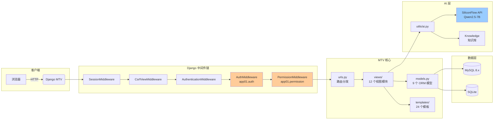
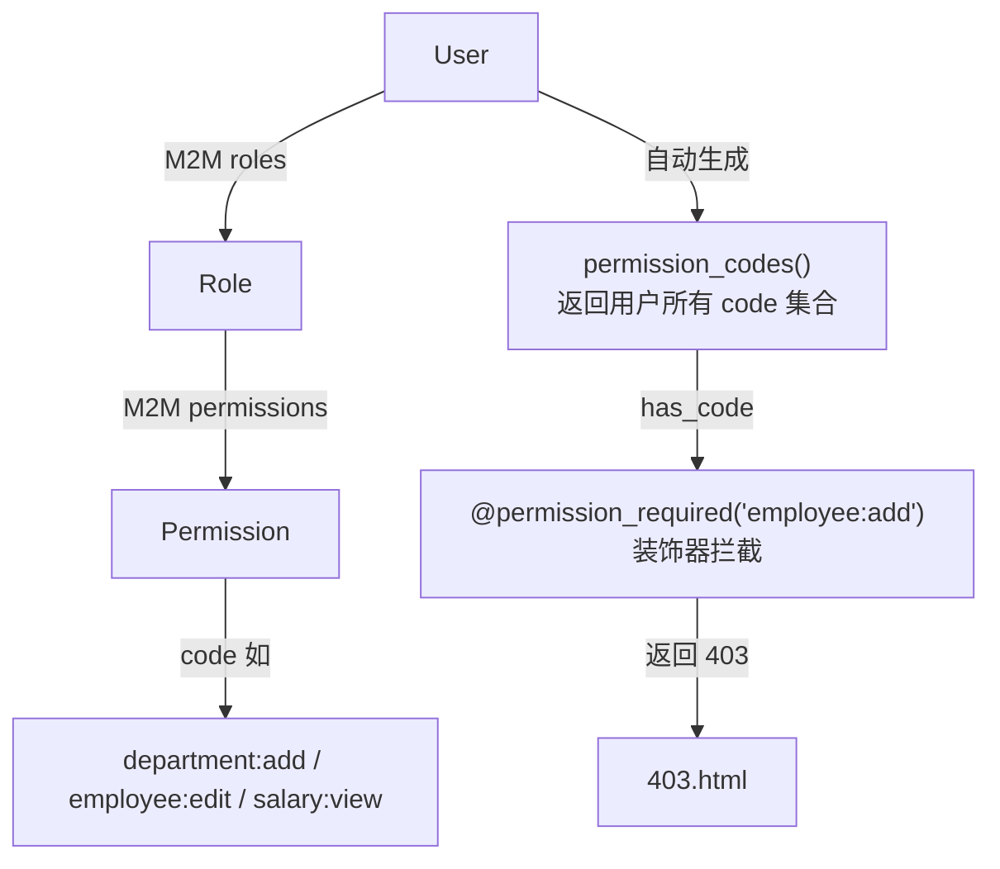

# 企业员工管理系统 HRMS

> Django 5.2 + MySQL/SQLite + RBAC + AI 智能助手
> 学生：方圣军 | 学号：24071120517 | 课程：软件开发框架

---

## 一、技术栈

| 类别 | 技术 |
|------|------|
| 后端 | Python 3.10 · Django 5.2.7 |
| 数据库 | MySQL 8.x（默认）/ SQLite（环境变量切换） |
| 数据库驱动 | PyMySQL 1.1.1 |
| 前端 | Bootstrap 3 · jQuery 3.6 · ECharts 5（数据可视化） |
| 图像 | Pillow 10.4（验证码 + 员工头像） |
| AI | SiliconFlow API · Qwen/Qwen2.5-7B-Instruct · openai SDK |
| 权限 | 自研 RBAC（User → Role → Permission 多对多） |
| 认证 | Django 内置 auth + 图片验证码 + Session |
| 部署 | `python manage.py runserver` 开发模式 |

---

## 二、系统架构



---

## 三、数据模型 ER 图

```mermaid
erDiagram
    Department ||--o{ Employee : "PROTECT"
    Department ||--o{ User : "SET_NULL"
    User ||--o{ Employee : "SET_NULL"
    User ||--o{ Notice : "SET_NULL"
    User ||--o{ Task : "CASCADE"
    User }o--|| Role : "M2M roles"
    Role }o--|| Permission : "M2M permissions"
    Employee ||--o{ Attendance : "CASCADE"
    Employee ||--o{ Salary : "CASCADE"

    Department {
        int id PK
        varchar name UK 部门名称
        varchar desc 描述
        datetime create_time 创建时间
    }

    Permission {
        int id PK
        varchar code UK 权限编码
        varchar name 权限名
        varchar module 所属模块
    }

    Role {
        int id PK
        varchar name UK 角色名
        varchar desc 描述
    }

    User {
        int id PK
        varchar username UK 用户名
        varchar password 密码(内置加密)
        varchar phone 手机
        int depart_id FK 部门
    }

    Employee {
        int id PK
        varchar name 姓名
        int age 年龄
        int gender 性别
        decimal account 账户余额
        varchar phone UK 手机
        int depart_id FK 部门
        int user_id O2O 关联用户
    }

    Attendance {
        int id PK
        int employee_id FK 员工
        date date 日期
        time check_in 签到
        time check_out 签退
        int status 状态
    }

    Salary {
        int id PK
        int employee_id FK 员工
        varchar month 月份YYYY-MM
        decimal base_salary 基本工资
        decimal bonus 奖金
        decimal deduction 扣款
        decimal total 实发(自动算)
    }

    Notice {
        int id PK
        varchar title 标题
        text content 正文
        int publisher_id FK 发布人
        bool is_top 是否置顶
    }

    Task {
        int id PK
        int level 级别 紧急/重要/普通
        varchar title 标题
        text detail 详情
        int leader_id FK 负责人
    }

    Knowledge {
        int id PK
        varchar title 标题
        text content 知识库正文
    }
```

### 关键设计点

| 模型 | 特殊设计 | 位置 |
|------|---------|------|
| `User` | 继承 `AbstractUser`，自定义 `phone` + `depart` + `roles` M2M | `models.py` |
| `Attendance` | `unique_together = (employee, date)`；`save()` 自动算 status | `models.py` |
| `Salary` | `unique_together = (employee, month)`；`save()` 自动算 `total = base + bonus - deduction` | `models.py` |
| `Employee` | `phone` 全局唯一；头像按月存 | `models.py` |
| `Department` | `PROTECT` 外键 — 有员工时不能删部门 | `models.py` |

---

## 四、RBAC 权限体系



**核心代码片段（User 模型方法）：**

```python
def permission_codes(self):
    """返回该用户所有权限 code 集合，QuerySet 先 prefetch_related"""
    if not hasattr(self, '_permission_codes_cache'):
        codes = set()
        for role in self.roles.prefetch_related('permissions'):
            codes.update(role.permissions.values_list('code', flat=True))
        self._permission_codes_cache = codes
    return self._permission_codes_cache

def has_code(self, code):
    return code in self.permission_codes()
```

**中间件拦截顺序（settings.py MIDDLEWARE）：**

```
1. SessionMiddleware          # 会话
2. CsrfViewMiddleware         # CSRF
3. AuthenticationMiddleware   # request.user 注入
4. AuthMiddleware             # 未登录 → /login/
5. PermissionMiddleware       # @permission_required → 403
```

---

## 五、模块清单

| 模块 | 视图文件 | 模板 | 核心功能 |
|------|---------|------|---------|
| 首页 / 认证 | `views/home.py` · `auth.py` | `index.html` · `login.html` | 登录 / 注销 / 图形验证码 / 首页仪表盘 |
| 部门管理 | `views/department.py` | `department/list.html` · `form.html` | 列表 / 新增 / 编辑 / 删除（PROTECT） |
| 员工管理 | `views/employee.py` | `employee/list.html` · `form.html` | 列表 / 新增 / 编辑 / 删除 / 头像上传 |
| 考勤管理 | `views/attendance.py` | `attendance/list.html` · `form.html` | 打卡记录 / 状态自动计算（按时/迟到/早退/缺勤） |
| 薪资管理 | `views/salary.py` | `salary/list.html` · `form.html` | 按月薪资 / 实发自动计算 |
| 公告管理 | `views/notice.py` | `notice/list.html` · `form.html` | 发布公告 / 置顶切换 |
| 任务管理 | `views/task.py` | `task/list.html` | **AJAX 异步增删** / 三档级别 |
| 数据统计 | `views/stats.py` | `stats/index.html` | ECharts 部门人数柱状图 / 薪资趋势折线图 |
| AI 智能助手 | `views/ai.py` | `ai/index.html` · `ai/widget.html` | 招聘 JD 生成 / 制度知识库问答 / 薪资点评 / 浮窗聊天 |
| 用户管理 | `views/system.py` | `system/user_list.html` · `user_roles.html` | 给用户分配角色 |
| 角色管理 | `views/system.py` | `system/role_list.html` · `role_permissions.html` | 给角色分配权限 |

### 路由总表（`app01/urls.py`）

```python
# 认证
path('', home_views.index)           # 首页
path('login/', auth_views.login_view)
path('logout/', auth_views.logout_view)
path('captcha/', auth_views.captcha_view)   # 验证码图片

# CRUD 四件套（department / employee / attendance / salary）
path('<module>/', <module>_list)
path('<module>/add/', <module>_add)
path('<module>/edit/<int:pk>/', <module>_edit)
path('<module>/delete/<int:pk>/', <module>_delete)

# 公告
path('notice/top/<int:pk>/', notice_toggle_top)

# 任务（AJAX）
path('task/', task_list)
path('task/add/', task_add)

# 统计（ECharts 数据源）
path('stats/department-data/', department_chart_data)
path('stats/salary-data/', salary_trend_data)

# AI（四个能力点）
path('ai/jd/', generate_jd)          # 招聘 JD 生成
path('ai/qa/', knowledge_qa)         # 制度问答
path('ai/comment/', salary_comment)  # 薪资点评
path('ai/chat/', assistant_chat)     # 浮窗聊天

# RBAC 管理
path('system/user/<int:pk>/roles/', user_roles)
path('system/role/<int:pk>/permissions/', role_permissions)
```

---

## 六、中间件 & 工具类

| 文件 | 作用 |
|------|------|
| `middleware/auth.py` | 拦截未登录用户跳转 `/login/`，白名单：`/login/` `/captcha/` `/static/` `/media/` |
| `middleware/permission.py` | 匹配视图函数上的 `@permission_required('xxx:yyy')` 装饰器，无权限返回 403 |
| `templatetags/rbac.py` | 模板里用 `` 控制按钮显示 |
| `utils/captcha.py` | PIL 生成 4 位随机字母 + 干扰线，session 存答案 |
| `utils/pagination.py` | 通用分页组件：页码容错 / 边界钳制 / 保留 `request.GET` 搜索词 |
| `utils/ai.py` | 封装 OpenAI SDK 调用 SiliconFlow，带重试 + 上下文注入 |
| `utils/prompts.py` | 系统 prompt 模板（JD 生成 / 制度问答 / 薪资点评） |
| `utils/scope.py` | 数据范围过滤（普通员工只看自己的记录） |

---

## 七、AI 智能助手（亮点功能）


### 配置（`settings.py` 全部环境变量，避免硬编码）

```python
AI_API_KEY = os.environ.get('AI_API_KEY', '')
AI_BASE_URL = os.environ.get('AI_BASE_URL', 'https://api.siliconflow.cn/v1')
AI_MODEL   = os.environ.get('AI_MODEL',   'Qwen/Qwen2.5-7B-Instruct')
```

### 知识库问答流程

1. 提取用户问题关键词（分词 + 停用词过滤）
2. `Knowledge.objects.filter(title__contains=kw | content__contains=kw)` 取 Top N
3. 把检索到的段落拼进 system prompt 作为上下文
4. 调用大模型生成答案

---

## 八、运行部署

### MySQL 模式（默认）

```powershell
$env:DB_NAME     = "hrms"
$env:DB_USER     = "root"
$env:DB_PASSWORD = "Root@123456"
$env:DB_HOST     = "127.0.0.1"
$env:DB_PORT     = "3306"
python manage.py migrate
python manage.py runserver
```

### SQLite 模式（零依赖）

```powershell
$env:DB_ENGINE = "sqlite"
python manage.py migrate
python manage.py runserver
```

### 初始化数据

```powershell
python manage.py init_data   # 建超级管理员 admin/admin123
python manage.py demo_data   # 生成 100 条员工 + 考勤 + 薪资模拟数据
```

---

## 九、依赖清单

```
Django>=5.2,<5.3
PyMySQL>=1.1.1
Pillow>=10.4.0
openai>=1.0.0
pydantic>=2.0.0
```

---

## 十、仓库地址

| 仓库 | 说明 |
|------|------|
| **https://github.com/FSJ796/3th-fsj** | HRMS 企业员工管理系统（本项目） |
| https://github.com/FSJ796/2nd-fsj | ems 联通用户管理系统（课程设计起步项目） |

---

## 十一、目录结构

```
qiyeguanlixitong/
├── app01/
│   ├── middleware/          # AuthMiddleware + PermissionMiddleware
│   ├── management/commands/ # init_data / demo_data
│   ├── migrations/          # 0001_initial / 0002_knowledge
│   ├── static/              # Bootstrap / jQuery / ECharts
│   ├── templates/           # 24 个 HTML 模板
│   ├── templatetags/        # rbac.py 自定义权限模板标签
│   ├── utils/               # ai / captcha / pagination / prompts / scope
│   ├── views/               # 12 个视图模块（按业务拆分）
│   ├── models.py            # 9 个 ORM 模型
│   ├── forms.py             # ModelForm
│   └── urls.py              # 76 行路由表
├── hrms/                    # Django project config
│   ├── settings.py          # 双 DB 引擎 + AI 环境变量
│   └── urls.py
├── manage.py
├── requirements.txt
└── PROJECT.md               # 本文档
```
