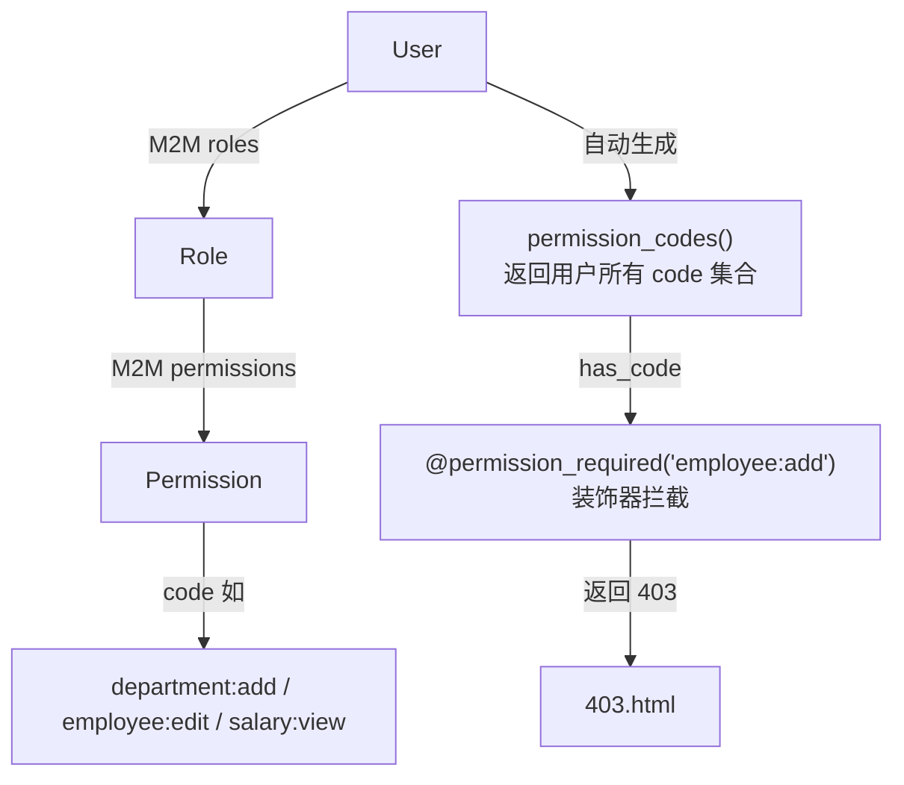
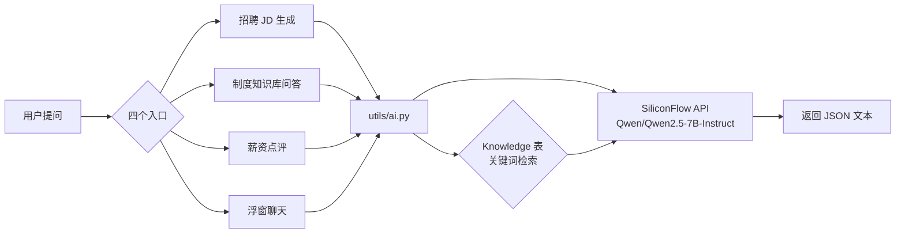

# 企业员工管理系统 HRMS

> Django 5.2 + MySQL/SQLite + RBAC + AI 智能助手
> 学生：方圣军 | 学号：24071120517 | 课程：软件开发框架

---

## 一、技术栈

| 类别 | 技术 |
|------|------|
| 后端 | Python 3.10 · Django 5.2.7 |
| 数据库 | MySQL 8.x（默认）/ SQLite（环境变量切换） |
| 数据库驱动 | PyMySQL 1.1.1 |
| 前端 | Bootstrap 3 · jQuery 3.6 · ECharts 5（数据可视化） |
| 图像 | Pillow 10.4（验证码 + 员工头像） |
| AI | SiliconFlow API · Qwen/Qwen2.5-7B-Instruct · openai SDK |
| 权限 | 自研 RBAC（User → Role → Permission 多对多） |
| 认证 | Django 内置 auth + 图片验证码 + Session |
| 部署 | `python manage.py runserver` 开发模式 |

---

## 二、系统架构

```mermaid
flowchart LR
    subgraph 客户端
        A[浏览器] -->|HTTP| B(Django MTV)
    end

    subgraph Django 中间件链（settings.py 注册 8 个）
        B --> C[SecurityMiddleware]
        C --> D[SessionMiddleware]
        D --> E[CommonMiddleware]
        E --> F[CsrfViewMiddleware]
        F --> G[AuthenticationMiddleware]
        G --> H[MessageMiddleware]
        H --> I[XFrameOptionsMiddleware]
        I --> J[AuthMiddleware\napp01.auth]
    end

    subgraph MTV 核心
        J --> K[urls.py\n路由分发]
        K --> L[views/\n12 个视图模块]
        L --> M[models.py\n9 个 ORM 模型]
        L --> N[templates/\n24 个模板]
    end

    subgraph 数据层
        M --> O[(MySQL 8.x\nutf8mb4)]
        M --> P[(SQLite\nDB_ENGINE=sqlite)]
    end

    subgraph AI 层
        L --> Q[utils/ai.py]
        Q --> R[SiliconFlow API\nQwen/Qwen2.5-7B-Instruct]
        Q --> S[Knowledge 表\n关键词检索]
    end

    style J fill:#ffcc99
    style R fill:#99ccff
    style S fill:#ffcc99
```

---

## 三、数据模型 ER 图

```mermaid
erDiagram
    Department ||--o{ Employee : "PROTECT"
    Department ||--o{ User : "SET_NULL"
    User ||--o{ Employee : "SET_NULL"
    User ||--o{ Notice : "SET_NULL"
    User ||--o{ Task : "CASCADE"
    User }o--|| Role : "M2M roles"
    Role }o--|| Permission : "M2M permissions"
    Employee ||--o{ Attendance : "CASCADE"
    Employee ||--o{ Salary : "CASCADE"

    Department {
        int id PK
        varchar name UK 部门名称
        varchar desc 描述
        datetime create_time 创建时间
    }

    Permission {
        int id PK
        varchar code UK 权限编码
        varchar name 权限名
        varchar module 所属模块
    }

    Role {
        int id PK
        varchar name UK 角色名
        varchar desc 描述
    }

    User {
        int id PK
        varchar username UK 用户名
        varchar password 密码(内置加密)
        varchar phone 手机
        int depart_id FK 部门
    }

    Employee {
        int id PK
        varchar name 姓名
        int age 年龄(正数)
        varchar gender 性别('男'/'女')
        decimal account 账户余额
        date create_time 入职时间
        varchar phone UK 手机
        int depart_id FK 部门(PROTECT)
        int user_id O2O 关联账号(SET_NULL)
    }

    Attendance {
        int id PK
        int employee_id FK 员工
        date date 日期
        time check_in 签到(nullable)
        time check_out 签退(nullable)
        varchar status 状态('按时'/'迟到'/'早退'/'缺勤')
    }

    Salary {
        int id PK
        int employee_id FK 员工
        varchar month 月份YYYY-MM
        decimal base_salary 基本工资
        decimal bonus 奖金
        decimal deduction 扣款
        decimal total 实发(editable=False 自动算)
    }

    Notice {
        int id PK
        varchar title 标题
        text content 正文
        int publisher_id FK 发布人(SET_NULL)
        bool is_top 是否置顶
    }

    Task {
        int id PK
        varchar level 级别('紧急'/'重要'/'普通')
        varchar title 标题
        text detail 详情
        int leader_id FK 负责人(CASCADE)
    }

    Knowledge {
        int id PK
        varchar title 标题
        text content 知识库正文
    }
```

### 关键设计点

| 模型 | 特殊设计 | 位置 |
|------|---------|------|
| `User` | 继承 `AbstractUser`，自定义 `phone` + `depart` + `roles` M2M | `models.py` |
| `Attendance` | `unique_together = (employee, date)`；`save()` 自动算 status | `models.py` |
| `Salary` | `unique_together = (employee, month)`；`save()` 自动算 `total = base + bonus - deduction` | `models.py` |
| `Employee` | `phone` 全局唯一；头像按月存 | `models.py` |
| `Department` | `PROTECT` 外键 — 有员工时不能删部门 | `models.py` |

---

## 四、RBAC 权限体系



**核心代码片段（User 模型方法，`app01/models.py`）：**

```python
def permission_codes(self):
    """返回当前用户拥有的权限编码集合（超级管理员拥有全部权限）。"""
    if not hasattr(self, '_perm_cache'):
        # 超级管理员视为拥有系统全部权限
        if self.is_superuser:
            self._perm_cache = set(Permission.objects.values_list('code', flat=True))
        else:
            self._perm_cache = set(
                Permission.objects.filter(roles__users=self)
                .values_list('code', flat=True)
            )
    return self._perm_cache

def has_code(self, code):
    """判断用户是否拥有指定权限编码。"""
    return self.is_superuser or code in self.permission_codes()
```

> 缓存属性 `_perm_cache` 挂在实例上，同一请求内多次调用不重复查库。
> 注意：项目里 `middleware/permission.py` 虽存在但**未注册到 settings.py**，
> 权限判断实际由视图函数上的装饰器 + 模板标签 `rbac.py` 完成。

**真实中间件链（settings.py MIDDLEWARE 8 个）：**

```
1. SecurityMiddleware        # 安全头
2. SessionMiddleware         # 会话
3. CommonMiddleware          # 通用（URL 规范化）
4. CsrfViewMiddleware        # CSRF 防护
5. AuthenticationMiddleware  # request.user 注入
6. MessageMiddleware         # flash 消息
7. XFrameOptionsMiddleware   # 点击劫持防护
8. AuthMiddleware            # 自定义：未登录 → /login/
```

---

## 五、模块清单

| 模块 | 视图文件 | 模板 | 核心功能 |
|------|---------|------|---------|
| 首页 / 认证 | `views/home.py` · `auth.py` | `index.html` · `login.html` | 登录 / 注销 / 图形验证码 / 首页仪表盘 |
| 部门管理 | `views/department.py` | `department/list.html` · `form.html` | 列表 / 新增 / 编辑 / 删除（PROTECT） |
| 员工管理 | `views/employee.py` | `employee/list.html` · `form.html` | 列表 / 新增 / 编辑 / 删除 / 头像上传 |
| 考勤管理 | `views/attendance.py` | `attendance/list.html` · `form.html` | 打卡记录 / 状态自动计算（按时/迟到/早退/缺勤） |
| 薪资管理 | `views/salary.py` | `salary/list.html` · `form.html` | 按月薪资 / 实发自动计算 |
| 公告管理 | `views/notice.py` | `notice/list.html` · `form.html` | 发布公告 / 置顶切换 |
| 任务管理 | `views/task.py` | `task/list.html` | **AJAX 异步增删** / 三档级别 |
| 数据统计 | `views/stats.py` | `stats/index.html` | ECharts 部门人数柱状图 / 薪资趋势折线图 |
| AI 智能助手 | `views/ai.py` | `ai/index.html` · `ai/widget.html` | 招聘 JD 生成 / 制度知识库问答 / 薪资点评 / 浮窗聊天 |
| 用户管理 | `views/system.py` | `system/user_list.html` · `user_roles.html` | 给用户分配角色 |
| 角色管理 | `views/system.py` | `system/role_list.html` · `role_permissions.html` | 给角色分配权限 |

### 路由总表（`app01/urls.py`）

```python
# 认证
path('', home_views.index, name='index')
path('login/', auth_views.login_view, name='login')
path('logout/', auth_views.logout_view, name='logout')
path('captcha/', auth_views.captcha_view, name='captcha')

# 部门管理 CRUD
path('department/',        department_views.department_list)
path('department/add/',    department_views.department_add)
path('department/edit/<int:pk>/', department_views.department_edit)
path('department/delete/<int:pk>/', department_views.department_delete)

# 员工管理 CRUD
path('employee/',          employee_views.employee_list)
path('employee/add/',      employee_views.employee_add)
path('employee/edit/<int:pk>/', employee_views.employee_edit)
path('employee/delete/<int:pk>/', employee_views.employee_delete)

# 考勤管理 CRUD
path('attendance/',        attendance_views.attendance_list)
path('attendance/add/',    attendance_views.attendance_add)
path('attendance/edit/<int:pk>/', attendance_views.attendance_edit)
path('attendance/delete/<int:pk>/', attendance_views.attendance_delete)

# 薪资管理 CRUD
path('salary/',            salary_views.salary_list)
path('salary/add/',        salary_views.salary_add)
path('salary/edit/<int:pk>/', salary_views.salary_edit)
path('salary/delete/<int:pk>/', salary_views.salary_delete)

# 公告：列表 / 发布 / 置顶切换
path('notice/',            notice_views.notice_list)
path('notice/add/',        notice_views.notice_add)
path('notice/top/<int:pk>/', notice_views.notice_toggle_top)

# 任务（AJAX 异步）
path('task/',              task_views.task_list)
path('task/add/',          task_views.task_add)

# 统计（ECharts 数据源）
path('stats/',             stats_views.stats_index)
path('stats/department-data/', stats_views.department_chart_data)
path('stats/salary-data/',     stats_views.salary_trend_data)

# AI（四个能力点）
path('ai/',                ai_views.ai_index)
path('ai/jd/',             ai_views.generate_jd)          # 招聘 JD 生成
path('ai/qa/',             ai_views.knowledge_qa)           # 制度知识库问答
path('ai/comment/',        ai_views.salary_comment)        # 薪资点评
path('ai/chat/',           ai_views.assistant_chat)        # 浮窗聊天

# RBAC 管理
path('system/user/',       system_views.user_list)
path('system/user/<int:pk>/roles/', system_views.user_roles)
path('system/role/',       system_views.role_list)
path('system/role/<int:pk>/permissions/', system_views.role_permissions)
```

> 完整路由表 26 条，实际位于 `app01/urls.py`（76 行含注释）。

---

## 六、中间件 & 工具类

**中间件 & 工具类：**

| 文件 | 作用 |
|------|------|
| `middleware/auth.py` | 拦截未登录用户跳转 `/login/`；白名单：`/login/` `/captcha/` `/static/` `/media/` |
| `middleware/permission.py` | ⚠️ 文件存在但**未注册**到 MIDDLEWARE；项目实际用模板标签 + 视图装饰器做权限判断 |
| `templatetags/rbac.py` | 模板里 `` 控制按钮显隐 |
| `utils/captcha.py` | PIL 生成 4 位随机字母 + 干扰线，session 存答案 |
| `utils/pagination.py` | 通用分页：页码容错 / 边界钳制 / 保留 `request.GET` 搜索词 |
| `utils/ai.py` | 封装 OpenAI SDK 调 SiliconFlow，30 秒超时，欠费/超时由上层降级 |
| `utils/prompts.py` | 系统 prompt 模板（JD 生成 / 制度问答 / 薪资点评） |
| `utils/scope.py` | 数据范围过滤（普通员工只看自己的记录） |

---

## 七、AI 智能助手（亮点功能）



### 配置（`settings.py` 全部环境变量，避免硬编码）

```python
AI_API_KEY = os.environ.get('AI_API_KEY', '')
AI_BASE_URL = os.environ.get('AI_BASE_URL', 'https://api.siliconflow.cn/v1')
AI_MODEL   = os.environ.get('AI_MODEL',   'Qwen/Qwen2.5-7B-Instruct')
```

### 知识库问答流程

1. 问题去标点后生成 2–4 字 n-gram 关键词，过滤“怎么/什么/如何”等停用词
2. 先整句 `icontains` 匹配标题与正文；无命中再按关键词 OR 查询，按命中数排序取前 5 条
3. 把检索到的段落拼进 system prompt 作为上下文，要求“只能根据资料回答”
4. 调用大模型生成答案；无检索结果时不调用模型，直接回答“不知道”
5. 模型欠费、超时或网络异常时，降级返回最相关制度原文，避免已知问题也提示失败

---

## 八、运行部署

### MySQL 模式（默认）

```powershell
$env:DB_NAME     = "hrms"
$env:DB_USER     = "root"
$env:DB_PASSWORD = "Root@123456"
$env:DB_HOST     = "127.0.0.1"
$env:DB_PORT     = "3306"
python manage.py migrate
python manage.py runserver
```

### SQLite 模式（零依赖）

```powershell
$env:DB_ENGINE = "sqlite"
python manage.py migrate
python manage.py runserver
```

### 初始化数据

```powershell
python manage.py init_data   # 建权限、角色与超级管理员 fsj/fsj123
python manage.py demo_data   # 6 部门 / 15 员工 / 225 条考勤 / 90 条薪资 / 8 条知识库
```

---

## 九、依赖清单

```
Django==5.2.7
PyMySQL==1.1.1
Pillow==10.4.0
openai>=1.40.0
cryptography>=42.0.0
```

---

## 十、仓库地址

| 仓库 | 说明 |
|------|------|
| **https://github.com/FSJ796/3th-fsj** | HRMS 企业员工管理系统（本项目） |
| https://github.com/FSJ796/2nd-fsj | ems 联通用户管理系统（课程设计起步项目） |

---

## 十一、目录结构

```
qiyeguanlixitong/
├── app01/
│   ├── middleware/          # auth.py(已注册) + permission.py(未注册，备用)
│   ├── management/commands/ # init_data 建超级管理员 / demo_data 造模拟数据
│   ├── migrations/          # 0001_initial / 0002_knowledge
│   ├── static/              # Bootstrap 3 / jQuery / ECharts
│   ├── templates/           # 24 个 HTML 模板 + partials 子组件
│   ├── templatetags/        # rbac.py 权限判断模板标签
│   ├── utils/               # ai / captcha / pagination / prompts / scope
│   ├── views/               # 12 个视图模块（auth/home/dept/emp/attend/salary/notice/task/stats/system/ai）
│   ├── models.py            # 9 个 ORM 模型
│   ├── forms.py             # ModelForm（表单生成）
│   └── urls.py              # 26 条路由，76 行含注释
├── hrms/                    # Django project config
│   ├── settings.py          # 双 DB 引擎 + AI 环境变量
│   └── urls.py
├── manage.py
├── requirements.txt
└── PROJECT.md               # 本文档
```
